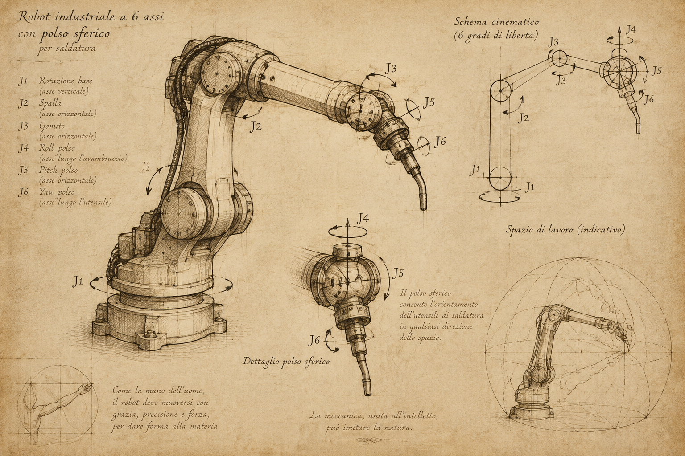

# MCP Robot Welding Simulator

**MCP Robot Welding Simulator** — прототип MCP-сервиса для планирования, кинематической валидации и постпроцессинга программ дуговой сварки промышленными манипуляторами.

Сервис поддерживает:

- 6-DoF промышленный манипулятор со сферическим запястьем
- 6-DoF коллаборативный манипулятор с offset-wrist
- 4-DoF SCARA с призматической осью
- Пользовательские кинематические профили из JSON-конфигураций

Проект демонстрирует инженерный подход к интеграции LLM в робототехнические системы: языковая модель не формирует управляющие команды для приводов напрямую. Она работает через типизированные MCP Tools, а детерминированный планировщик, решатель IK и валидатор сцены проверяют траекторию до генерации программы для контроллера.

---

<p align="center">
  
</p>

> **Важно:** результат сервиса предназначен для офлайн-анализа и симуляции. Он не является разрешением на запуск сгенерированной программы на реальном оборудовании. Перед производственным применением необходимо проверить геометрию робота и инструмента, крепление базы, систему координат инструмента, контроллер, сварочный источник, ограничения безопасности и параметры сварочного процесса.

## Ключевой принцип

LLM не является источником истины для безопасности и корректности робототехнической программы.

### Роль LLM / MCP-клиента

- Интерпретировать запрос оператора на естественном языке.
- Выбирать кинематический профиль манипулятора.
- Выбирать идентификаторы сварных швов и технологические параметры.
- Вызывать MCP Tools в правильной последовательности.
- Объяснять пользователю результат планирования или причину отказа.

### Роль детерминированного ядра

- Решать прямую и обратную кинематику N-DoF манипулятора.
- Использовать SE(3)/SO(3), геометрический якобиан и damped least squares.
- Контролировать суставные ограничения.
- Контролировать непрерывность траектории в пространстве обобщённых координат.
- Проверять статические коллизии упрощённой геометрии звеньев с окружающей средой и заготовкой.
- Компилировать проверенную траекторию в целевой диалект контроллера.

## Архитектура

```text
User / MCP Client (LLM Agent)
        │
        ▼  Model Context Protocol
MCP Server (Industrial-Robot-Welding-Simulator)
        │
        ├─► list_supported_robots()
        │       └─► Robot profiles loaded from configs/robots/*.json
        │
        ├─► inspect_workpiece()
        │       └─► Workpiece metadata and available weld seams
        │
        ├─► plan_and_simulate_weld()
        │       ├─► HOME → APPROACH → WELD → RETRACT → TRANSIT → HOME
        │       ├─► N-DoF inverse kinematics
        │       ├─► Joint-limit and continuity checks
        │       ├─► Cartesian weld-path validation
        │       └─► Static capsule/AABB collision checks
        │
        └─► export_robot_program(plan_id, dialect)
                └─► MELFA-BASIC-style or generic G-code output
```

MCP разделяет resources, tools и prompts; tools вызываются моделью, а resources предоставляют контекст приложения.

## Реализованные MCP Tools

### `list_supported_robots()`

Возвращает доступные кинематические профили роботов, загруженные из `configs/robots/*.json`.

Для каждого профиля возвращаются:

- `robot_type`
- `description`
- `dof`
- `max_reach_mm`
- `tool_z_points_into_workpiece`
- `position_only_orientation`

### `inspect_workpiece()`

Возвращает:

- Имя заготовки.
- Доступные сварные швы.
- Начальную и конечную точки каждого шва.
- Нормаль поверхности.
- Длину шва.
- Тип сварного соединения.

### `plan_and_simulate_weld()`

Строит и валидирует траекторию:

```text
HOME_SAFE
→ seam_APPROACH
→ seam_START
→ seam_MID
→ seam_END
→ seam_RETRACT
→ seam_SAFE_TRANSIT
→ RETURN_HOME
```

Для каждого шва сервис:

- Решает IK для точек подхода, начала, середины, конца и отхода.
- Проверяет непрерывность конфигураций между соседними точками.
- Проверяет всю декартову траекторию сварки с дискретизацией.
- Проверяет коллизии упрощённых звеньев и инструмента.
- Добавляет безопасную транзитную точку после каждого шва.
- Возвращается в домашнюю позицию через безопасный транзит.

Пример запроса:

```json
{
  "seam_ids": ["seam_top_rib", "seam_left_flange"],
  "weld_speed_mm_s": 30.0,
  "approach_clearance_mm": 40.0,
  "robot_type": "industrial_6dof"
}
```

Успешный ответ содержит `plan_id`, который необходимо передать в `export_robot_program()`.

### `export_robot_program(plan_id, dialect, program_name)`

Компилирует ранее созданный и сохранённый план в программу контроллера.

Поддерживаемые диалекты:

- `melfa` — MELFA-BASIC-style вывод.
- `gcode` — generic metric G-code-style вывод.

Пример:

```json
{
  "plan_id": "plan_a1b2c3d4e5f6",
  "dialect": "melfa",
  "program_name": "BRACKET_WELD_01"
}
```

Использование `plan_id` предотвращает экспорт устаревшей или другой глобальной траектории при параллельных запросах.

## MCP Resource

### `scene://workpiece/seams`

Возвращает метаданные заготовки и доступные сварные швы в формате JSON.

## Уровень валидации

Успешный план имеет статус:

```json
{
  "status": "VALIDATED_OK",
  "validation_level": "kinematic_and_static_collision"
}
```

Это означает, что план прошёл:

- Проверку достижимости IK.
- Проверку суставных ограничений.
- Проверку непрерывности конфигураций.
- Проверку декартовой траектории сварки.
- Статическую проверку коллизий на основе capsule/AABB-аппроксимаций.

Это **не** означает:

- Полную mesh-точную проверку коллизий.
- Проверку самоколлизий.
- Проверку кабелей, dress pack и реальной геометрии фланца.
- Проверку динамики, скорости, ускорения и рывков.
- Валидацию конкретного контроллера или сварочного источника.
- Безопасность для запуска на реальном роботе.

## Добавление нового робота

Кинематические модели хранятся в `configs/robots/*.json`. Новый робот добавляется без изменения Python-кода.

Создайте файл, например `configs/robots/custom_6dof.json`:

```json
{
  "robot_type": "custom_6dof",
  "description": "Custom 6-DoF articulated welding arm",
  "max_reach_mm": 1300.0,
  "position_only_orientation": false,
  "tool_z_points_into_workpiece": true,
  "dh_table": [
    {
      "a": 150.0,
      "alpha_deg": -90.0,
      "d": 400.0,
      "theta_offset_deg": 0.0,
      "joint_type": "revolute"
    },
    {
      "a": 550.0,
      "alpha_deg": 0.0,
      "d": 0.0,
      "theta_offset_deg": -90.0,
      "joint_type": "revolute"
    },
    {
      "a": 120.0,
      "alpha_deg": -90.0,
      "d": 0.0,
      "theta_offset_deg": 0.0,
      "joint_type": "revolute"
    },
    {
      "a": 0.0,
      "alpha_deg": 90.0,
      "d": 500.0,
      "theta_offset_deg": 0.0,
      "joint_type": "revolute"
    },
    {
      "a": 0.0,
      "alpha_deg": -90.0,
      "d": 0.0,
      "theta_offset_deg": 0.0,
      "joint_type": "revolute"
    },
    {
      "a": 0.0,
      "alpha_deg": 0.0,
      "d": 120.0,
      "theta_offset_deg": 0.0,
      "joint_type": "revolute"
    }
  ],
  "joint_limits": [
    { "min": -170.0, "max": 170.0, "unit": "deg" },
    { "min": -135.0, "max": 135.0, "unit": "deg" },
    { "min": -150.0, "max": 160.0, "unit": "deg" },
    { "min": -185.0, "max": 185.0, "unit": "deg" },
    { "min": -135.0, "max": 135.0, "unit": "deg" },
    { "min": -350.0, "max": 350.0, "unit": "deg" }
  ],
  "seeds": [
    [0.0, 0.0, 0.0, 0.0, 0.0, 0.0]
  ]
}
```

Поддерживаемые поля DH-параметров:

| Поле | Единицы | Описание |
|---|---:|---|
| `a` / `a_mm` | mm | Длина звена |
| `alpha` / `alpha_deg` | rad / deg | Twist звена |
| `d` / `d_mm` | mm | Смещение вдоль оси сустава |
| `theta_offset` / `theta_offset_deg` | rad / deg | Смещение угла сустава |
| `joint_type` | — | `revolute` или `prismatic` |

Для углов можно использовать либо радианы, либо градусы, но не оба представления одновременно.

## Запуск и проверка

```bash
python3 -m venv .venv
source .venv/bin/activate
pip install -e ".[dev]"
```

Запуск тестов:

```bash
pytest -v
```

Запуск MCP-сервера через stdio:

```bash
python3 -m mcp_robot_welding.mcp_server
```

Запуск демонстрации:

```bash
python3 demo.py
```

## Пример сгенерированной программы

Пример MELFA-BASIC-style вывода:

```basic
' PROGRAM: BRACKET_WELD_01
' ROBOT MODEL: industrial_6dof
' GENERATED BY MCP-ROBOT-WELDING-SIM
' WARNING: Validate controller syntax, tool frame, and welding I/O.

Servo On
Ovrd 100

P1 = (450.000, 0.000, 420.000, 0.000, 0.000, 0.000)(6, 0)
P2 = (480.000, 0.000, 220.000, 0.000, 0.000, 0.000)(6, 0)
P3 = (480.000, 0.000, 180.000, 0.000, 0.000, 0.000)(6, 0)

JOvrd 40.0
Mov P1 ' HOME_SAFE
Mov P2 ' seam_top_rib_APPROACH

Spd 30.000
Mvs P3 ' seam_top_rib_START
ArcStart 1 ' CONFIGURED ARC_START

Spd 30.000
Mvs P4 ' seam_top_rib_MID
Mvs P5 ' seam_top_rib_END

ArcEnd 1 ' CONFIGURED ARC_END
Mov P6 ' seam_top_rib_RETRACT
Mov P7 ' seam_top_rib_SAFE_TRANSIT

Servo Off
End
```

Команды дуги (`ArcStart`, `ArcEnd`) являются конфигурируемыми заполнителями. Их необходимо заменить на команды, поддерживаемые конкретным контроллером и сварочным источником.

## Ограничения

- Коллизии проверяются с использованием AABB и capsule-аппроксимаций, а не точной CAD/mesh-геометрии.
- Проверка самоколлизий звеньев не реализована.
- Не моделируются кабели, dress pack, реальные геометрия фланца и геометрия сварочной горелки.
- Не проверяются динамика, ускорения, рывки, грузоподъёмность и параметры сварочного процесса.
- Сгенерированные программы являются шаблонами для интеграции, а не готовыми производственными программами.
- Команды включения/выключения дуги зависят от контроллера и сварочного источника.

## Дальнейшее развитие

- Переход от AABB к BVH/OBB и mesh-точной проверке коллизий.
- Проверка самоколлизий и полная геометрия робота, фланца, горелки и кабелей.
- Интеграция с ROS 2, MoveIt 2, Gazebo и промышленными симуляторами.
- Расширение постпроцессоров для KUKA KRL, ABB RAPID и FANUC TP.
- Проверка динамических ограничений и планирование с учётом скорости и ускорения.
- Очередь задач, хранение планов и программ, телеметрия и human-in-the-loop подтверждение перед загрузкой на реальный контроллер.

## Математическая основа

Подробное описание кинематических моделей (SE(3)/SO(3), аналитический геометрический якобиан, решатель Левенберга — Марквардта с затуханием) и пространственного индексирования доступно в [docs/ARCHITECTURE.md](docs/ARCHITECTURE.md). 

## CUDA-бенчмарк пространственного индексирования

Для ускорения широкой фазы обнаружения коллизий (Broad-Phase Collision Detection) в [notebooks/cuda_morton_broadphase_benchmark.ipynb](notebooks/cuda_morton_broadphase_benchmark.ipynb) реализовано CUDA-ядро расчёта 30-битных кодов Мортона (Z-order кривой) со структурой данных **Structure of Arrays (SoA)**: 

* **Объём сцены:** 1 000 000 3D-примитивов
* **CPU (NumPy):** 37.23 ms
* **GPU (NVIDIA T4 CUDA Kernel):** 0.201 ms (**185.2x ускорение**, побитовая верификация 100%)

Это экспериментальная часть проекта, а не обязательный компонент текущего MCP-планировщика.